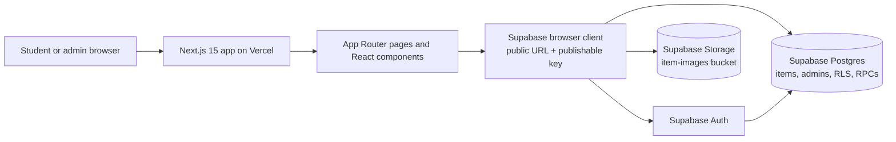
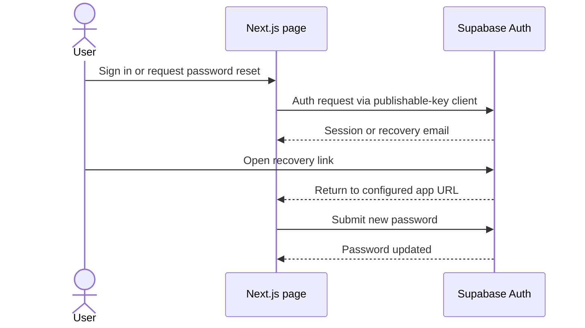
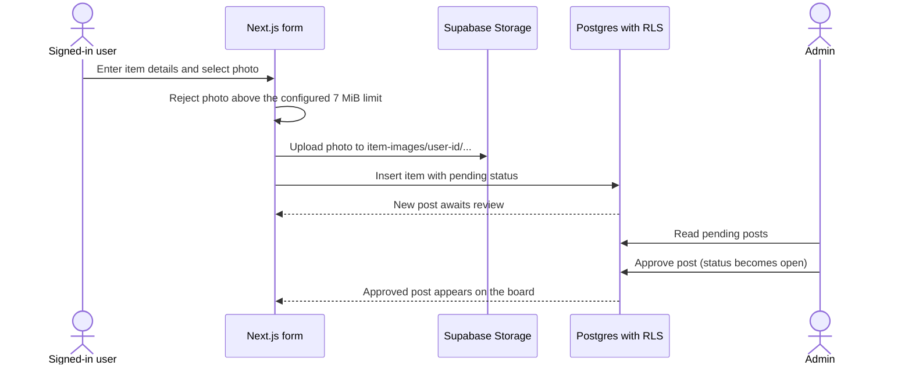

# Lost & Found App Architecture

## System overview

The browser uses the Supabase **publishable** key. Authorization is enforced by Supabase Auth, Postgres Row Level Security (RLS), and Storage policies; browser UI checks are only for presentation. A service-role key must never be placed in the frontend.

## Application layers

| Layer | Responsibility |
| --- | --- |
| `app/` | Next.js routes: home, item board, item details, new post, login, password recovery/reset, and admin review. |
| `components/` | Shared UI and interactions: navigation, auth provider/forms, item cards/form, filters, return action, theme, and feedback. |
| `lib/supabaseClient.js` | Creates the browser Supabase client from `NEXT_PUBLIC_SUPABASE_URL` and `NEXT_PUBLIC_SUPABASE_PUBLISHABLE_KEY` (or the legacy anon key fallback). |
| Supabase Auth | Sign-in, sign-up, sessions, email verification, and password recovery. Auth identities live in `auth.users`. |
| Supabase Postgres | Item data, admin membership, policies, and protected functions. |
| Supabase Storage | Item photos in the `item-images` bucket. The app uses public image URLs for display. |
| Vercel | Hosts the Next.js app. Production and Preview deployments are selected by the Vercel Git branch configuration. |

## Main data and access rules

- `public.items` stores lost/found posts, ownership, status, photo path, and post details. New posts enter `pending`; approved posts are `open`; an owner can mark an eligible post `returned`.
- `public.admins` stores trusted admin user IDs, linked to `auth.users`. The `public.is_admin()` database function is used by policies to check the signed-in identity.
- RLS is the security boundary for reading and changing item rows. Admins can review pending submissions; an admin can delete any item after the Phase 10 migration is installed.
- Contact information and private found-item details should be exposed through the project's restricted database functions/policies, not by broadening public item reads.
- An optional reward description belongs to a lost-item post. It is informational; the app does not process payments.
- `item-images` stores photos. Signed-in users upload under their own user ID path; admins can inspect and delete item images when the admin image policies are installed.

## Key flows

### Sign in and password recovery

Configure the Supabase Auth Site URL and allowed redirect URLs for both local development and the deployed site. The recovery link must return to `/reset-password` so the user can enter a new password.

### Submit and review a post

The database sets the pending status so a browser cannot publish a post by choosing a different status. The file-size check in the UI improves feedback; the bucket's server-side `file_size_limit` is the enforcement backstop.

### Admin deletes a post

The admin page asks for confirmation, removes the item's photo from Storage when present, and deletes the item row. Storage select/delete policies and the item delete RLS policy must both permit the admin. Database policies remain authoritative even if someone calls Supabase directly from outside the UI.

## Routes

| Route | Purpose |
| --- | --- |
| `/` | Landing page and latest posts. |
| `/items` | Browse, search, and filter approved posts. |
| `/items/[id]` | Item detail and permitted contact/details. |
| `/items/new` | Signed-in user submits a lost/found post and optional photo. |
| `/login` | Sign in and create an account. |
| `/forgot-password` | Request a recovery email. |
| `/reset-password` | Set a new password from a valid recovery session. |
| `/admin` | Admin review queue and post management. |

## Deployment and configuration

- Vercel builds the Next.js app; set `NEXT_PUBLIC_SUPABASE_URL` and `NEXT_PUBLIC_SUPABASE_PUBLISHABLE_KEY` in the deployment environment.
- Keep the Supabase publishable key public by design; never expose a service-role or database secret in `NEXT_PUBLIC_*` variables.
- Preview deployments use the branch configured for previews; production uses the branch configured as Vercel Production Branch.
- Supabase Auth redirect allow-lists must include the deployed domain and local development URL.
- No Git or deployment action was performed while creating this document.

## Phase 10 prerequisite

For the current admin-delete and larger-photo changes to work against Supabase, run [`supabase/phase-10-admin-delete-and-7mb-photos.sql`](supabase/phase-10-admin-delete-and-7mb-photos.sql) in the Supabase SQL Editor after Phase 8. This migration raises the bucket limit to 7 MiB and adds admin item/photo delete policies. The document does not assume that the migration has already been applied to the hosted Supabase project.
